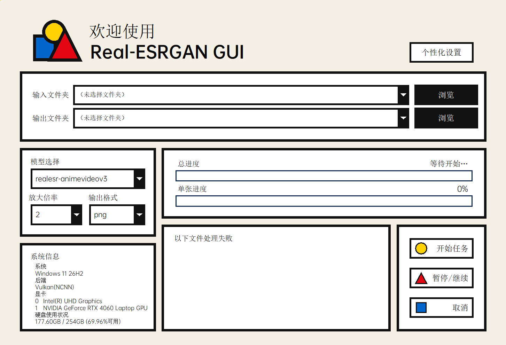

# Real-ESRGAN GUI

图片高清放大工具。选择文件夹，一键把里面的图片放大 2 / 3 / 4 倍：支持子文件夹批量处理、暂停继续、失败重试，全程 GPU 加速，无需命令行。

## 下载

到 [Releases](../../releases) 页面下载，二选一：

| 文件 | 大小 | 适合谁 |
| --- | --- | --- |
| `RealESRGAN_GUI_FULL.exe` | 约 82 MB | **大多数用户**：引擎和模型全部内置，下载后放到任意文件夹双击即用，不依赖任何其他文件 |
| `RealESRGAN_GUI.exe` | 约 22 MB | 想自己管理引擎或添加模型：需要把 `Real ESRGAN` 文件夹放在 exe 旁边（连同下载） |

## 系统要求

- Windows 10 / 11（64 位）
- 支持 Vulkan 的显卡（NVIDIA / AMD / Intel 核显都可以）
- 无需安装 Python 或任何运行环境

## 快速开始

1. 下载 `RealESRGAN_GUI_FULL.exe`，放到任意文件夹，双击打开（首次启动需等待几秒）。
2. 选择「输入文件夹」和「输出文件夹」。
3. 选好模型、放大倍率和输出格式，点击「开始任务」。
4. 处理完成后会弹出系统通知，结果就在输出文件夹里。

## 使用说明

### 选择文件夹

- 输入文件夹里的图片（包括子文件夹里的）都会被处理，输出保持相同的子文件夹结构。
- 支持的图片格式：jpg / jpeg / png / webp / bmp。
- 点击输入框右侧的小箭头，可以查看最近用过的 10 个文件夹，直接选用。
- **右键**「浏览」按钮：直接在资源管理器中打开当前所选的文件夹。

### 模型、倍率与格式

- **模型**：默认内置 `realesr-animevideov3`（适合动漫风格图片和视频截图）。
- **放大倍率**：下拉框里只显示当前模型支持的倍率（x2 / x3 / x4）。
- **输出格式**：png / jpg / webp。
- 想用其他 Real-ESRGAN 模型？请使用 `RealESRGAN_GUI.exe` + `Real ESRGAN` 文件夹的组合：把模型的 `.param` 和 `.bin` 文件放进 `Real ESRGAN\models`（文件名形如 `模型名-x2.param`、`模型名-x2.bin`），重新打开程序即可在下拉框中看到。FULL 版的模型是内置的，不提供外加。

### 任务控制

- **开始任务**：开始处理；处理中界面会锁定，防止误改路径。
- **暂停/继续**、**取消**：仅处理中可用。
- 两条进度条：**总进度** = 已完成张数 / 总张数；**单张进度** = 当前这张图自己的百分比。
- 处理完成后会弹出 Windows 系统通知。

### 失败的文件怎么办

- 处理失败的文件会列在「以下文件处理失败」面板中（鼠标滚轮可翻页）。
- **重试**：只重新处理失败的文件。
- **导出失败图片**：把失败的原图复制到你指定的文件夹。
- 确认不要了：点击「忽略失败」清空列表。

### 个性化设置

- 右上角「个性化设置」打开设置面板。
- **中文字体 / 西文字体**：分别选择，可输入关键词筛选；选择会自动保存。
- **上传字体**：支持 ttf / otf / ttc，导入后即可选用。
- 更换字体后界面会自动调整宽窄，任何字体下文字都不会被截断或超出边框。

### 系统信息

- 显示系统版本、后端、显卡列表。
- 硬盘可用空间显示的是输出文件夹所在盘，约每 2 秒刷新。

## 常见问题

**双击后要等几秒才有窗口？**
正常现象。FULL 版启动时需要载入内置的引擎和模型。

**杀毒软件报毒 / 文件被删除？**
个别杀毒软件会对打包的程序误报，把文件加入信任列表或恢复即可。请只从本项目的 Releases 页面下载。

**输出图片在哪里、叫什么名字？**
在输出文件夹里，文件名与原图相同、扩展名换成所选格式；子文件夹结构保持一致。

**FULL 版和普通版怎么选？**
只是处理图片 → FULL 版；想添加自己的模型 → 普通版 + `Real ESRGAN` 文件夹。

**暂停/取消按钮是灰的？**
这两个按钮只在任务处理中可用。

## 更新日志

- [CHANGELOG.md](CHANGELOG.md)：最新版本的更新内容
- [UPDATE.md](UPDATE.md)：所有版本的完整更新记录

## 第三方组件

本程序调用的引擎与模型来自以下开源项目，其版权声明与许可文本见 [THIRD-PARTY-NOTICES.md](THIRD-PARTY-NOTICES.md)：

- [realesrgan-ncnn-vulkan](https://github.com/xinntao/realesrgan-ncnn-vulkan)（推理引擎，MIT License，基于 [Real-ESRGAN](https://github.com/xinntao/Real-ESRGAN) 模型，BSD 3-Clause License）
- [ncnn](https://github.com/Tencent/ncnn)（腾讯开源推理框架，MIT License）
- 界面字体：OPPO Sans（OPPO 官方宣布可免费商用）
